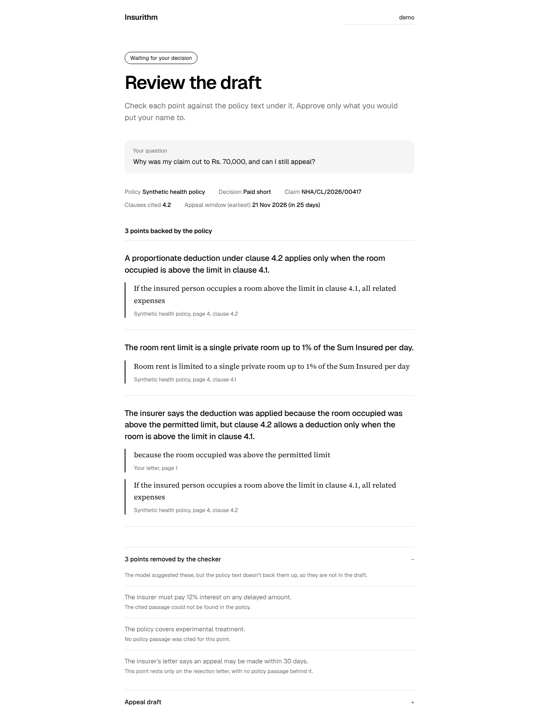
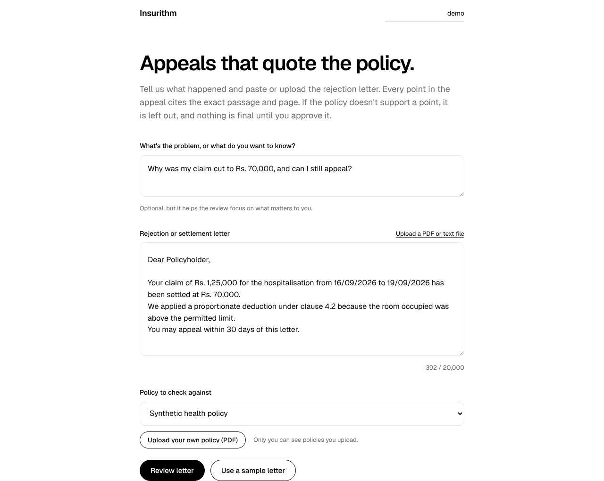
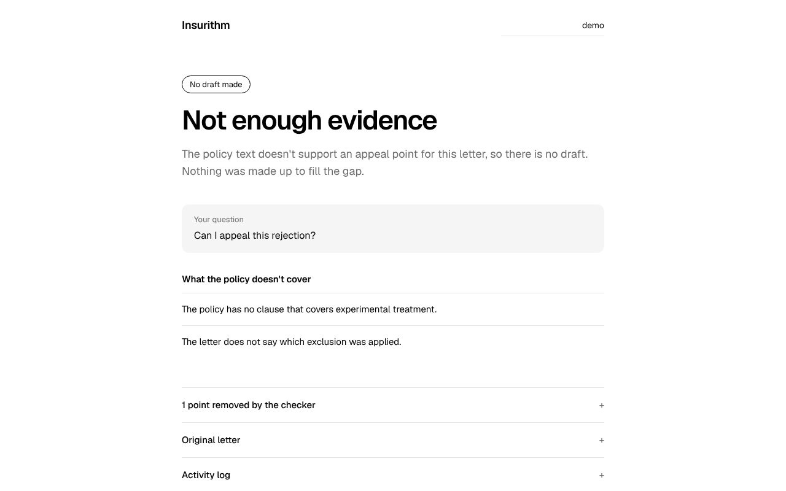
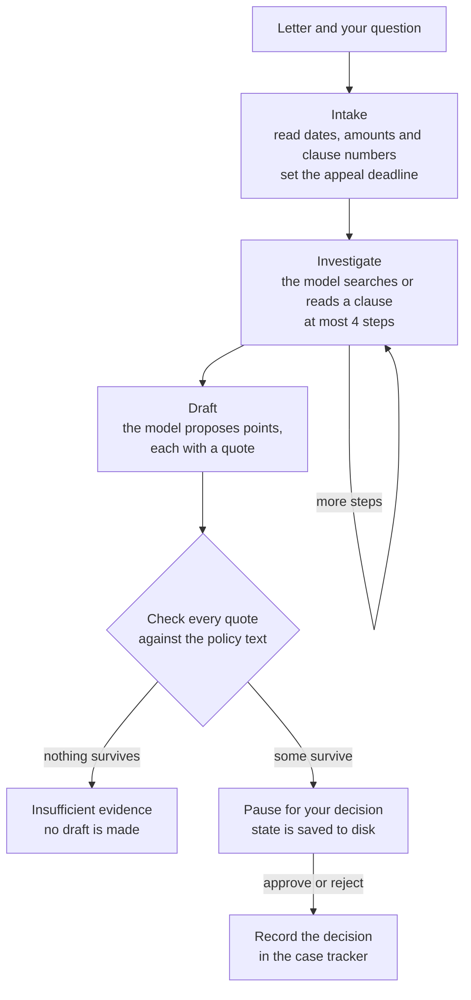
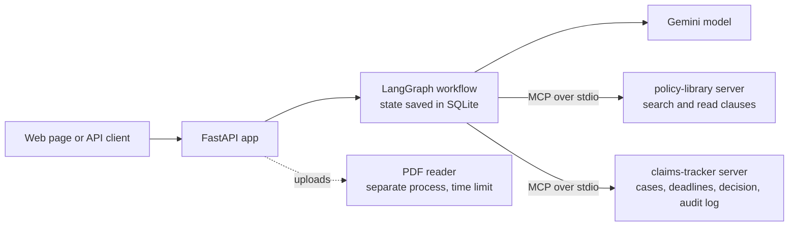

# Insurithm

An evidence-grounded agentic AI system for health insurance appeals.

When a health claim is rejected, delayed or paid short, it is hard to tell which policy clause was used, whether the policy really supports that decision, and what to send back. Insurithm reads the rejection letter and the policy, finds the clauses that matter, and drafts an appeal in which every point cites a document, a page and an exact passage. If the policy does not support a point, it says "insufficient evidence" instead of making one up. Nothing is final until a person approves it.

It is a research project. It is not legal, medical or insurance advice, and it never sends anything to an insurer.

## Screenshots

<p></p>

The review screen. Each point sits above the exact policy passage it quotes. Points the checker could not back up are listed with the reason, and nothing is final until you approve.

<table>
<tr>
<td width="50%"></td>
<td width="50%"></td>
</tr>
<tr>
<td>Start page: say what you want to know, paste or upload the letter, pick or upload a policy.</td>
<td>When the policy supports nothing, it says so and makes no draft.</td>
</tr>
</table>

These screenshots use the sample letter and the fictional sample policy, with a scripted model standing in for Gemini.

## What it does

A letter goes in through an HTTP API. The workflow then:

1. reads dates, amounts, clause numbers and the appeal window from the letter with regular expressions, and records the deadline;
2. lets a language model search the policy, a few steps at most, through an MCP server;
3. asks the model for findings, each with a quotation from a specific chunk;
4. checks every quotation against the source and drops anything that does not match;
5. pauses for a person to approve or reject the draft, with the state saved to disk;
6. records the decision in a case tracker with an audit trail.

### How a review runs



### How the pieces connect



Example output (from `python examples/offline_demo.py`, which uses a scripted model so it needs no API key):

```
1. A proportionate deduction under clause 4.2 applies only when the room occupied is above the limit in clause 4.1.
   Evidence (policy synthetic_health_policy, page 4, clause 4.2): "If the insured person occupies a room above the limit in clause 4.1, all related expenses"

dropped by the citation checker:
  - The insurer must pay 12% interest on any delayed amount.  [no_valid_citation]
  - The policy covers experimental treatment.  [no_citations]
```

## The four things it is built around

| Requirement | Where it lives | How it is tested |
| --- | --- | --- |
| **Evidence-backed decisions.** Each point links to a document, page and passage. Missing evidence is reported, not papered over. | `verify.py` checks every citation; chunks carry page numbers and character offsets (`ingest.py`); an empty result becomes `insufficient_evidence`. | `tests/test_verify.py`, `tests/test_workflow.py` |
| **Human approval that survives a restart.** The run pauses, saves its state, and resumes after approve or reject. | `agent/workflow.py` (LangGraph `interrupt()` with an SQLite checkpointer). | `tests/test_restart_process.py` kills the process while it waits and finishes the run from a new one. |
| **Real MCP servers.** Two separate processes with narrow tools, schema validation, errors and access control. | `mcp_servers/policy_library.py`, `mcp_servers/claims_tracker.py`, client in `agent/tools.py`. | `tests/test_mcp_wire.py` starts them as child processes and calls them over stdio. |
| **Measured results.** Synthetic cases with expected passages; Recall, citation correctness, answer correctness and unsupported-claim rate; a non-agentic RAG baseline. | `evals/compare.py`, `agent/baseline.py`, `data/gold/gold_cases.json`. | `tests/test_compare.py` checks the harness with scripted models. |

Design notes and the threat model are in [docs/architecture.md](docs/architecture.md). Metric definitions and caveats are in [docs/evaluation.md](docs/evaluation.md).

## Status

Everything above is implemented and tested, and the agent and the baseline have been compared once with a real model. The harness and the Gemini client are also covered by tests that use scripted models and a mock server, so the suite needs no key.

**Result.** One run on 2026-10-26 with `gemini-3.5-flash-lite`: 15 synthetic cases (10 where an appeal is justified, 5 where the evidence is not enough). Raw output: `evals/reports/comparison_gemini-3.5-flash-lite.json` and `.md`.

| Metric | Agent | Baseline |
| --- | --- | --- |
| Expected passages found by search (16 in total) | 0.938 (15) | 0.625 (10) |
| Citation correctness (quotes that check out / quotes given) | 1.000 | 1.000 |
| Unsupported claims, as the model proposed them | 0.059 | 0.000 |
| Unsupported claims, as shipped to the user | 0.000 | 0.000 |
| Answer correctness, 10 appeal cases | 0.600 (6) | 0.300 (3) |
| Evidence coverage, 16 expected passages | 0.688 (11) | 0.375 (6) |
| Correctly said "insufficient evidence", 5 no-appeal cases | 1.000 | 1.000 |
| Wrongly said "insufficient evidence", 10 appeal cases | 0.000 | 0.200 (2) |
| Model calls per case | 4.67 | 1.00 |
| Cases that ended in an error | 0 | 0 |

What it shows: with this model the agent found more of the passages the cases need (15 of 16 against 10) and gave the right answer in 6 of 10 appeal cases against 3. The baseline gave up on 2 appeal cases that did have evidence; the agent never did. Both refused all 5 cases that had no support. The agent costs about 4.7 times as many model calls.

What it does not show: about 6% of the claims the agent proposed were unsupported and the checker removed all of them, but the baseline proposed no unsupported claims in this run, so this run does not show the checker beating the baseline on that point. With 10 appeal cases, one case moves a score by 0.1. It is one run of one small model, model output varies from run to run, and the policy and cases were written by the same person. The agent still missed the right answer in 4 of the 10 appeal cases; why has not been analysed yet. Treat this as a check that the system behaves as designed and as a reason to test further, not as an accuracy figure.

Retrieval alone (BM25 on the 30 answerable policy questions) has been measured: Recall@1 0.667, Recall@3 0.933, Recall@5 1.000, MRR 0.797.

## Quick start

Python 3.11 or newer (the test suite passes on 3.11, 3.12 and 3.13).

```
python -m venv .venv
source .venv/bin/activate          # Windows: .venv\Scripts\activate
pip install -e ".[dev]"
pytest                             # under a minute; starts the MCP servers as real processes
python examples/offline_demo.py    # whole workflow, no API key
python -m insurithm.retrieval "emergency admission notice" -k 3    # search the policy from the terminal
```

### On Windows (PowerShell)

```
python -m venv .venv
.venv\Scripts\activate
pip install -e ".[dev]"

# search the policy wording: clause, page and relevance score
.venv\Scripts\python -m insurithm.retrieval "waiting period for pre-existing diseases"
# Rank 1 (Score: 14.36) | Page 3 [Clause 3.2] (SECTION 3 - WAITING PERIODS)
# Text: 3.2 Pre-existing Diseases: Expenses for pre-existing diseases are payable only after 36 months of
# continuous coverage under this policy.

# retrieval evaluation (BM25 on the gold questions)
.venv\Scripts\python -m insurithm.evals.retrieval_eval

# split the policy PDF into page-numbered chunks
.venv\Scripts\python -m insurithm.ingest data/policies/synthetic_health_policy.pdf --out chunks.jsonl

# full test suite
.venv\Scripts\pytest
```

Use `-k 5` with the search command to see more results, and `--policy path\to\other.pdf` to search a different policy.

### Web page

The API also serves a small black-and-white page at `/`. You say what the problem is or what you want to know, paste the rejection letter or upload it (PDF or text), and pick the policy to check it against. You can upload your own policy PDF too; only you can see and use what you upload. Then you read each point next to the policy text it quotes and approve or reject. It is plain HTML, CSS and JavaScript in `src/insurithm/web/`, with no build step.

```
python examples/demo_server.py     # no API key; the model is scripted, so use "Use a sample letter"
```

Then open http://127.0.0.1:8000. With a real model, start the API as below and open the same address. The name in the top corner is sent as `X-Owner-Id`, so cases stay private to whoever typed that name (a stand-in for real login).

### Run the API with Gemini

```
cp .env.example .env               # fill in GEMINI_API_KEY and GEMINI_MODEL
uvicorn insurithm.api:app_from_env --factory
```

Open http://localhost:8000/docs for the interactive docs. Callers identify themselves with an `X-Owner-Id` header (a stand-in for real authentication).

```
curl -s -X POST localhost:8000/cases -H 'X-Owner-Id: asha' -H 'content-type: application/json' \
  -d '{"case_id": "case-001", "question": "Why was my claim cut, and can I appeal?", "letter_text": "Date: 12 September 2026. Your claim is settled at Rs. 70,000 after a proportionate deduction under clause 4.2 because the room was above the limit. You may appeal within 30 days."}'

curl -s -X POST localhost:8000/cases/case-001/run -H 'X-Owner-Id: asha'        # stops at the review step
curl -s localhost:8000/cases/case-001 -H 'X-Owner-Id: asha'                    # case, deadlines, pending draft
curl -s -X POST localhost:8000/cases/case-001/decision -H 'X-Owner-Id: asha' -H 'content-type: application/json' \
  -d '{"decision": "approve", "reviewer": "asha", "comment": "looks right"}'
curl -s localhost:8000/cases/case-001/audit -H 'X-Owner-Id: asha'
```

If the model fails part-way, `run` answers 502 and calling it again continues from the step that failed.

Files go in as the raw request body (no multipart form):

```
curl -s -X POST localhost:8000/extract-letter -H 'X-Owner-Id: asha' --data-binary @letter.pdf      # returns the letter text
curl -s -X POST 'localhost:8000/policies?name=my-policy.pdf' -H 'X-Owner-Id: asha' --data-binary @my-policy.pdf
curl -s localhost:8000/policies -H 'X-Owner-Id: asha'                                              # shared policy plus yours
```

Limits: letters up to 5 MB and 30 pages, policies up to 15 MB and 200 pages, 5 uploaded policies per person. Text PDFs only, so a scan or a photo has to be turned into text first. An uploaded policy is saved under `insurithm_data/policies/` (git-ignored) and stays there; there is no delete button yet.

### Run the comparison

```
python -m insurithm.evals.compare --limit 2          # smoke test: checks the Gemini connection, a few minutes
python -m insurithm.evals.compare                    # all 15 cases, agent and baseline
```

It writes `evals/reports/comparison_<model>.json` and `.md`. The default pause between model calls is 5 seconds to stay inside free-tier rate limits; change it with `--min-interval`.

A full run is about 90 model calls (15 cases, one call for the baseline and about five for the agent), and the command prints a line for each. Things to know about the free tier:

- **Each model has its own limit.** If Gemini answers that the limit is used up, the run stops at once, says so, and keeps every case that finished. Run the same command with `--resume` after the limit resets (daily limits usually reset overnight, Pacific time), or set another `GEMINI_MODEL` and start again. `--resume` only retries cases that have not finished.
- **Overloaded models** (HTTP 503) and slow replies are retried a few times; a case that still fails is counted as a failure and the report is marked "Incomplete run". Do not quote an incomplete table. Run again with `--resume` to retry only those cases.
- **Slow models.** A reply can take over a minute. The wait defaults to 120 seconds; raise it with `GEMINI_TIMEOUT_SECONDS`.
- **Model names change.** Older models are retired for new accounts (you get a 404), so list the models your key can use and pick a current `flash` one rather than copying a name from here.

### Run the MCP servers on their own

```
python -m insurithm.mcp_servers.policy_library
INSURITHM_TRACKER_DB=tracker.sqlite python -m insurithm.mcp_servers.claims_tracker
```

Both speak MCP over stdio, so they can be attached to any MCP client.

## Layout

```
src/insurithm/
  ingest.py, retrieval.py      PDF -> page-numbered chunks with offsets; BM25 search (also a CLI)
  console.py                   keeps the CLIs from crashing on non-UTF-8 (older Windows) consoles
  facts.py                     dates, amounts, clause numbers, appeal window from a letter
  verify.py                    citation checker
  mcp_servers/                 policy-library and claims-tracker
  agent/llm.py                 Gemini client (httpx) and test doubles
  agent/tools.py               MCP client
  agent/workflow.py            LangGraph workflow, approval step, runner
  agent/baseline.py            non-agentic retrieve-then-answer baseline
  api.py                       FastAPI app
  web/                         the web page (index.html, assets/app.css, assets/app.js)
  evals/                       retrieval eval, agent-vs-baseline comparison
data/policies/                 synthetic policy (fictional insurer)
data/gold/                     30 policy questions, 15 appeal cases
tests/                         pytest suite
examples/offline_demo.py       full run with a scripted model
examples/demo_server.py        the web page with a scripted model, no API key
scripts/                       generator for the synthetic policy PDF
.github/workflows/tests.yml    runs pytest on Python 3.11, 3.12, 3.13
docs/                          architecture, evaluation
```

## License

MIT. See [LICENSE](LICENSE).

## Data

The policy in `data/policies/` and every letter in `data/gold/` are fictional. No real customer or medical documents are in this repository.

## Limitations

- The citation check proves a quotation exists where it is said to be. It does not prove the quotation means what the claim says; a word-overlap test catches obviously unrelated citations, and a person approves the result.
- The policy and the test cases were written by the same person, and there are only 15 cases. Treat any score as a check that the system behaves as designed, not as an accuracy figure.
- Text PDFs only (no OCR, tables are not parsed). Each review checks one policy. A policy that doesn't number its clauses like 4.2 is split by length instead, so quotes and page numbers still work but clause labels and the clause lookup don't.
- Uploaded files are untrusted and are read in a separate process with a time limit, but there is no virus scan, no rate limit, and no way to delete an upload from the page.
- The web page is a thin front for the API. It has no real login, and it was checked in Chromium only.
- Authentication is a header stub, there is no rate limiting, and data is not encrypted at rest.
- The workflow drafts and records. Sending an appeal to an insurer is left to the person.
